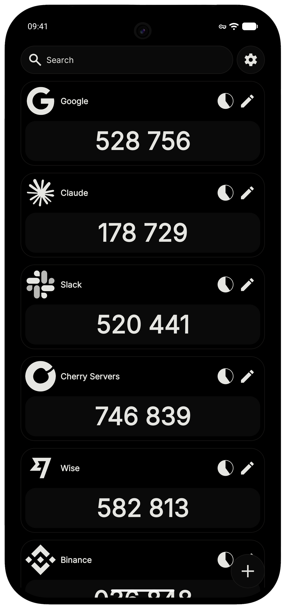

<p align="center">
  
</p>
<h1 align="center">2fa</h1>
<h4 align="center">A dedicated two-factor authenticator built to securely manage your one-time passwords</h4>
<p align="center">
    <a href="https://accrescent.app/app/app.ninesevennine.twofactorauthenticator.accrescent">
        
    </a>
</p>
<p align="center">
    
    
    
</p>

### Overview

2fa's only purpose is to provide single-use codes known as one-time passwords. It is a two-factor authenticator, and the concept is nothing new. There are plenty of other authenticators and alternatives with more features but with worse security and privacy than ours. We built 2fa to take full advantage of your device's hardware security, along with the latest cryptographic standards, to keep your accounts safe. The app is offline and includes unique features that no other authenticator app offers.

### Features

- Support for TOTP, HOTP, and Steam Guard codes.
- Add accounts via QR codes, OTPAuth links, files, or your gallery.
- Highly customizable, with account colors and icon packs, including textured and tinted options.
- Advanced security features such as biometric unlock, screen security, secure clipboard, lock on exit, and intent blocking.
- Automatic backups, along with manual export and import of your accounts in `.2fa` or Aegis `.json` formats.
- And more!

### Security

All accounts are encrypted and stored in the app's internal directory using our own proprietary format (extension `.2fa`). This format is the same whether the file is used internally or for exports. The only difference between them is where the cipher key comes from.

Currently they're encrypted using XChaCha20-Poly1305 with plans of switching to AEGIS-256. For exports and automatic backups, cipher keys are derived from hashing your passphrase with Argon2id using some very aggressive parameters, but we also enforce a minimum passphrase strength, and even the weakest passphrase we allow would take centuries to crack.

The cipher key that decrypts your accounts when you open the app doesn't come from a passphrase. During setup, you move your finger across the screen to generate entropy. We mix that with two independent calls to the OS cryptographic random number generator and run it all through SHA3-512 to produce two keys: one for accounts and one for your automatic backups. These two keys are stored together in what we call a **ClientSecret**. Both are generated at the same time, so the ClientSecret is never left partially filled with zeros. If you later choose to enable automatic backups with a passphrase, only the backup key gets overridden.

Of course the ClientSecret has to be stored somewhere. We encrypt it with AES-GCM, the most secure cipher available on the Android KeyStore, and try to generate the largest key possible on the Secure Element. If that fails, we step down in key size, and if the Secure Element isn't available at all, we repeat the process for the Trusted Execution Environment.

In the KeyStore generation process, if you're using biometrics, some special flags are set that can invalidate your key. This can happen if your lock screen changes, your private spaces change, your device updates, or if the app hasn't been opened in a while. 

These conditions depend on your device's software and firmware and might not always trigger. If your key is invalidated, the ClientSecret becomes permanently inaccessible. This is why we strongly recommend enabling automatic backups. They use the same `.2fa` format, sit in the same internal directory, but are encrypted with a passphrase you choose. If your key is ever invalidated, this is how you get your accounts back. Without an automatic backup or a previously exported backup, your accounts are gone. This is by design.

On top of that, we added a few features to keep your data from leaking in ways you might not expect. Here are some that might need a bit of explaining.

- **Incognito Keyboard:** Your keyboard normally remembers what you type to improve predictions, which means your account names, issuers, and secrets could end up stored in keyboard dictionaries. This prevents that by telling your keyboard to stop learning while you're in the app.

- **Secure Clipboard:** When you copy a code, your system can show it in clipboard previews, suggestions, and even sync it to other devices. This marks copied codes as extra sensitive so the system knows to hide them. If you want your keyboard or system to autofill codes, you should keep this disabled.

- **Lock on Exit:** When the app goes into the background, we securely erase the ClientSecret and all your account names, issuers, notes, and secrets from memory. This means you'll have to re-authenticate every time you open the app.

- **Block Intents:** On Android, other apps can send data into yours, like sharing an image or a link. We use this to let you add accounts by sharing QR code images or `otpauth://` links from other apps. The image decoding and QR parsing are handled by Android and ZXing, respectively, not by us. If an exploit exists in either of those, a malicious app could craft data specifically to trigger it. Enabling this drops all incoming data from other apps entirely, closing that attack surface at the cost of not being able to share into 2fa. We eventually want to replace both the image decoding and QR parsing with our own Rust implementations.

### Verifying Releases

All releases are signed and must have the following SHA-256 certificate fingerprint. The Google Play Store version is also signed, but Google may override it with their own fingerprint.

```bash
e5b28ea1e051c232dea94c27c0592e2c002d17c5ca81788b51306d608afe52c5
```

### Roadmap

We have a lot planned for 2026, though none of this is set in stone, and things might change along the way.

- **1.0** We are here
- **1.1** External QR scanner support
- **1.2** FIDO2 Unlock
- **1.3** Sync and cloud backups
- **1.4** iOS

### Support

If you have any problems using 2fa, found a bug, or just have a question, don't hesitate to reach us on [Discord](https://discord.gg/zxgXNzhYJu). If you'd like to support and accelerate our work, please consider [donating](https://979.st/donate/).