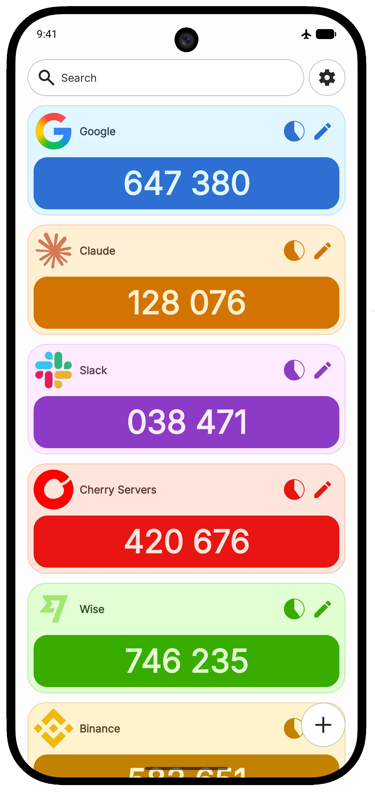
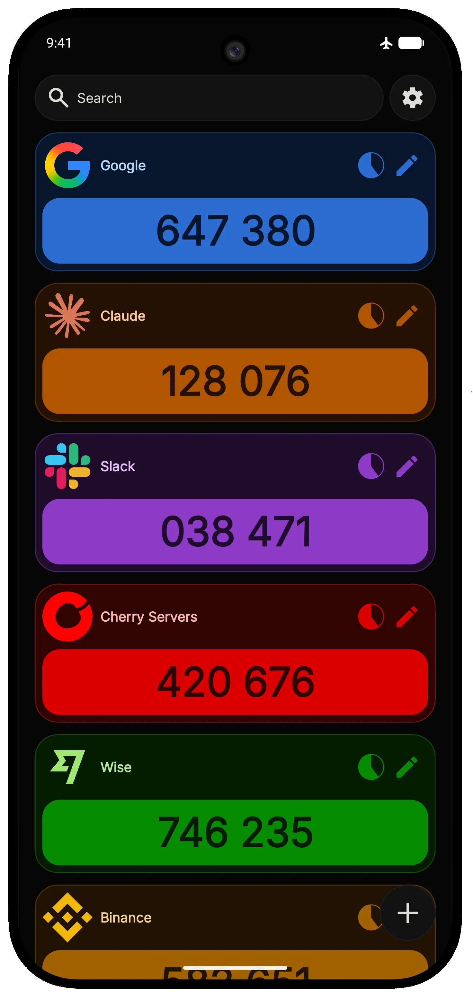
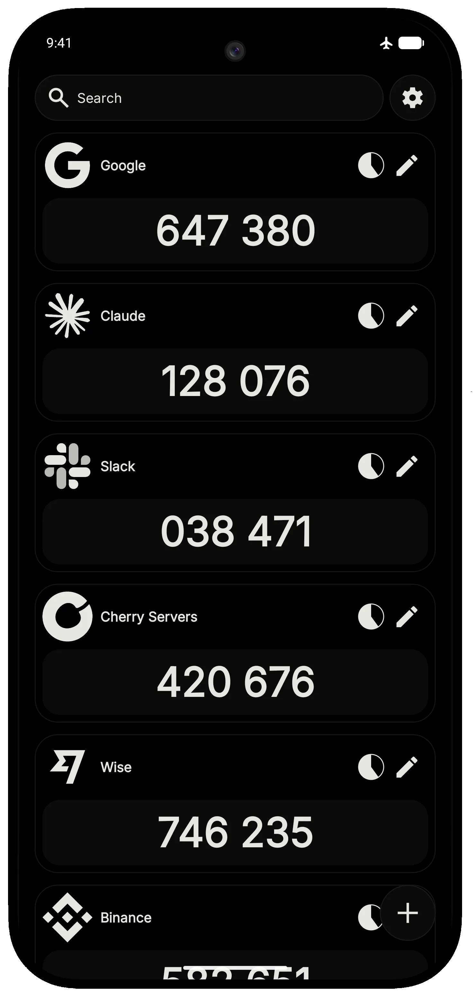

<p align="center">
  
</p>
<h1 align="center">2fa</h1>
<h4 align="center">A dedicated two-factor authenticator built to securely manage your one-time passwords</h4>
<p align="center">
    <a href="https://accrescent.app/app/app.ninesevennine.twofactorauthenticator.accrescent">
        
    </a>
    <a href="https://play.google.com/store/apps/details?id=app.ninesevennine.twofactorauthenticator.play">
        
    </a>
    <a href="https://apt.izzysoft.de/packages/app.ninesevennine.twofactorauthenticator">
        
    </a>
</p>
<p align="center">
    
    
    
</p>

### Overview

2fa's only purpose is to provide single-use codes known as one-time passwords. It is a two-factor authenticator, and the concept is nothing new. There are plenty of other authenticators and alternatives with more features but with worse security and privacy than ours. We built 2fa to take full advantage of your device's hardware security, along with the latest cryptographic standards, to keep your accounts safe. The app is offline and includes unique features that no other authenticator app offers.

### Features

- Support for [TOTP](https://en.wikipedia.org/wiki/Time-based_one-time_password), [HOTP](https://en.wikipedia.org/wiki/HMAC-based_one-time_password), and [Steam Guard](https://cs2central.gg/blog/steam-desktop-authenticator-guide) codes via `.maFile`.
- Add accounts via QR codes, OTPAuth links, files, or your gallery.
- Highly customizable, with account colors and icon packs, including textured and tinted options.
- Advanced security features such as biometric unlock, screen security, secure clipboard, lock on exit, and intent blocking.
- Manual export and import of accounts in `.2fa` or Aegis `.json` encrypted formats.
- And more!

### Security

All accounts are stored inside the app's internal directory using our format with the extension `.2fa`. They are encrypted with [AEGIS-256](https://doc.libsodium.org/doc/secret-key_cryptography/aead/aegis-256) and the key used is derived from hashing your passphrase with [Argon2id](https://veracrypt.io/en/Argon2id.html). This method is used for both exports and internal storage, with the only difference being that internal storage takes an additional step by running the hash through [HKDF](https://en.wikipedia.org/wiki/HKDF) using [SHA3-512](https://en.wikipedia.org/wiki/SHA-3) with an additional random salt on every disk write.

If you choose to use biometrics, the passphrase hash must be stored. It's encrypted using the Android Keystore with [AES-GCM](https://en.wikipedia.org/wiki/Advanced_Encryption_Standard) and [StrongBox](https://en.wikipedia.org/wiki/Secure_element) (when available). The result is saved in the `no_backup` folder, in a file named `unlock_passphrase_hash.bin`, meaning it won't be included in system backups or when transferring to a new device. Also, the biometric key can become invalid due to several reasons. If this happens, decrypting won't be possible, and you will have to enter your passphrase, after which you will be prompted to confirm biometrics in order to re-establish them.

On top of that, we added a few features to keep your data from leaking in ways you might not expect. Here are some that might need a bit of explaining.

- **Incognito Keyboard:** Your keyboard usually remembers what you type to improve its predictions. This means your usernames, passwords, and other secrets could end up stored in the keyboard dictionary. This feature prevents that by stopping your keyboard from learning while you are using the app.

- **Secure Clipboard:** When you copy a code, your system may display it in clipboard previews and suggestions, or even sync it to other devices. Copied codes are marked as extra sensitive so the system knows to hide them. If you want your keyboard or system to autofill codes, you should leave this feature disabled.

- **Lock on Exit:** When the app goes into the background, we securely erase the `unlock_passphrase_hash` and all of your account names, issuers, notes, and secrets from memory. This means you will have to re-authenticate every time you open the app.

- **Block Intents:** On Android, other apps can send data to yours, such as sharing an image or a link. We use this to let you add accounts by sharing QR code images or OTPAuth links from other apps. Image decoding and QR parsing are handled by Android and ZXing, respectively, rather than our own code. If an exploit exists in either of those tools, a malicious app could craft data specifically to trigger it. Enabling this feature drops all incoming data from other apps entirely, closing that attack surface at the cost of not being able to share directly into 2fa. We eventually plan to replace both image decoding and QR parsing with our own Rust implementations.

### Verifying Releases

All releases are signed and must match the following SHA-256 certificate fingerprints:

```
app.ninesevennine.twofactorauthenticator
E5:B2:8E:A1:E0:51:C2:32:DE:A9:4C:27:C0:59:2E:2C:00:2D:17:C5:CA:81:78:8B:51:30:6D:60:8A:FE:52:C5

app.ninesevennine.twofactorauthenticator.play
E5:B2:8E:A1:E0:51:C2:32:DE:A9:4C:27:C0:59:2E:2C:00:2D:17:C5:CA:81:78:8B:51:30:6D:60:8A:FE:52:C5
8B:E5:AB:1C:DC:0B:5D:B1:63:60:AB:4B:03:B2:37:13:71:B8:8D:28:4F:84:48:B1:13:A5:D6:8A:38:E5:B3:56 // Google's certificate fingerprint

app.ninesevennine.twofactorauthenticator.accrescent
E5:B2:8E:A1:E0:51:C2:32:DE:A9:4C:27:C0:59:2E:2C:00:2D:17:C5:CA:81:78:8B:51:30:6D:60:8A:FE:52:C5
```

When verifying, make sure to compare the hashes across multiple sources, such as our [website](https://979.st/2fa/verifying-releases).

### Translations

2fa is already available in several languages, and we would love your help adding more or improving the existing ones. You can do this by contributing to our [Codeberg Weblate](https://translate.codeberg.org/projects/979/2fa).

### Support

If you have any problems using 2fa, find a bug, or just have a question, don't hesitate to reach out to us on [Discord](https://discord.gg/zxgXNzhYJu). If you would like to support and accelerate our work, please consider [donating](https://979.st/donate).