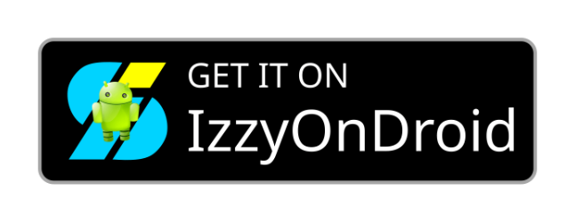
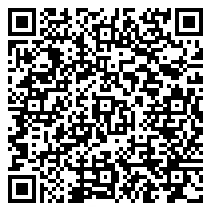
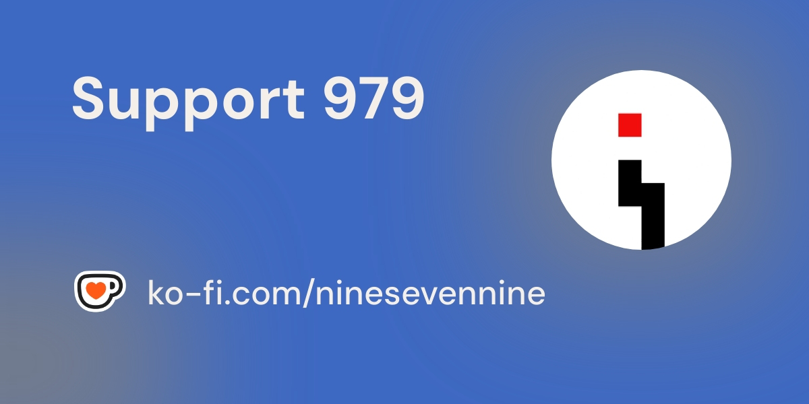

<p align="center">
  
</p>
<h1 align="center">2fa</h1>
<h4 align="center">The modern privacy and security focused two factor authenticator for HOTP, TOTP and Steam Guard codes</h4>
<p align="center">
    <a href="https://accrescent.app/app/app.ninesevennine.twofactorauthenticator.accrescent">
        
    </a>
    <a href="https://play.google.com/store/apps/details?id=app.ninesevennine.twofactorauthenticator.play">
        
    </a>
    <a href="https://apt.izzysoft.de/packages/app.ninesevennine.twofactorauthenticator">
        
    </a>
</p>
<p align="center">
    
    
    
</p>

### Overview

2fa is the modern privacy and security focused two factor authenticator. It is very easy to use and delivers exceptional security through modern cryptographic algorithms. The core is written in Rust and the app works fully offline without Google Play Services.

### Features

- Support for TOTP, HOTP, and Steam Guard codes via [`.maFile`](https://cs2central.gg/blog/steam-desktop-authenticator-guide).
- Add accounts via QR codes, OTPAuth links, files, or your gallery.
- Manual export and import of accounts in `.2fa` or Aegis `.json` formats.
- Advanced security features such as passphrases, biometric unlock, screen security, secure clipboard, lock on exit, and intent blocking.
- Highly customizable, with account colors and icon packs, including textured and tinted options.
- And more!

### Verify

Every release is signed with the same key. Before installing an APK from Codeberg or any mirror, check that it matches the following SHA-256 certificate.

```
E5:B2:8E:A1:E0:51:C2:32:DE:A9:4C:27:C0:59:2E:2C:00:2D:17:C5:CA:81:78:8B:51:30:6D:60:8A:FE:52:C5
```

*The Google Play Store version is signed by Google, not by us, and therefore won't match the above certificate.*

### Donate

2fa is free, has no ads, collects nothing, and is made by one person. It is sustained entirely by donations. Funds go toward test devices, developer account and infrastructure fees, and eventually a security audit.

If you value my work then you should definitely consider donating.

**Monero**



`43YaGjafqvwTZKqiE22MwQ1kVKYnG679pUXQnAzkos3WK2uoqJSeu9jRpko4VzKL9tHvFYRWbTUebcDDqkKiwJAL83arU6X`

**Ko-fi**

[](https://ko-fi.com/ninesevennine)

https://ko-fi.com/ninesevennine