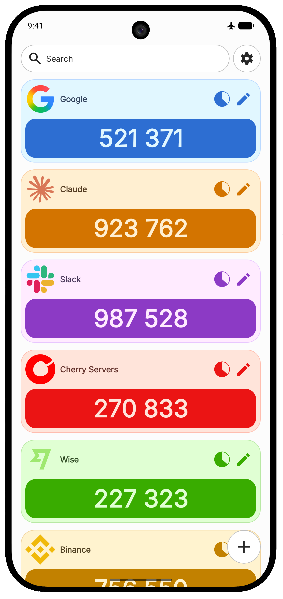
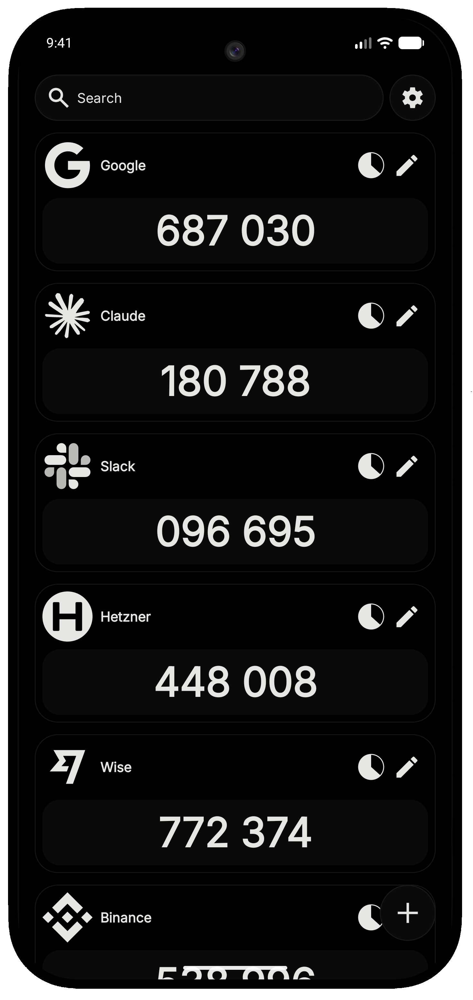

  

<h1 align="center">2fa</h1>
<h4 align="center">The modern privacy and security focused two factor authenticator for HOTP, TOTP and Steam Guard codes</h4>

    
    
    

    
    
    

### Overview

2fa is the modern privacy and security focused two factor authenticator. It is very easy to use and delivers exceptional security through modern cryptographic algorithms. The core is written in Rust and the app works fully offline without Google Play Services.

This fork is adapted from [979/2fa](https://codeberg.org/979/2fa) and adds Android 12 compatibility.

### Minimum Android Version

- Android 12 (API 31) or newer.
- Current builds support ARM64 (`arm64-v8a`) devices.
- On Android 12, the app uses the system language. In-app language overrides require Android 13 or newer.

### Tech Stack

- **Kotlin and Jetpack Compose:** Native Android interface with Material 3 and Navigation Compose.
- **Rust:** Native application core, exposed to Android through JNI.
- **AndroidX:** CameraX for camera integration and Biometric for biometric authentication.
- **Serialization:** Kotlinx Serialization and Rust Serde for JSON data handling.
- **Build tooling:** Gradle with Kotlin DSL, Cargo, and the Android NDK.

### Features

- Support for TOTP, HOTP, and Steam Guard codes via [`.maFile`](https://cs2central.gg/blog/steam-desktop-authenticator-guide).
- Add accounts via QR codes, OTPAuth links, files, or your gallery.
- Manual export and import of accounts in `.2fa` or Aegis `.json` formats.
- Advanced security features such as passphrases, biometric unlock, screen security, secure clipboard, lock on exit, and intent blocking.
- Highly customizable, with account colors and icon packs, including textured and tinted options.
- And more!

### Security

If you have any security concerns, please reach out to me on [Telegram](https://t.me/rc_exdee).

### Contribute

Contributions are welcome. Feel free to [raise an issue](https://github.com/bhodrolok/2fa-app/issues) to report a bug, suggest a feature, or discuss an improvement, or [open a pull request](https://github.com/bhodrolok/2fa-app/pulls) with code or documentation changes.

For bug reports, include your Android version, device model, and steps to reproduce the problem. For larger changes, please open an issue first so the approach can be discussed.