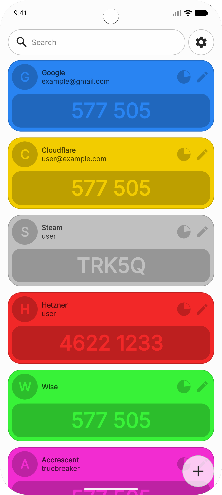
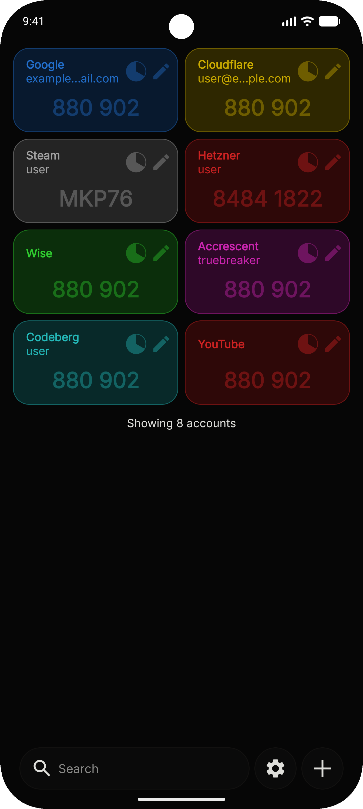
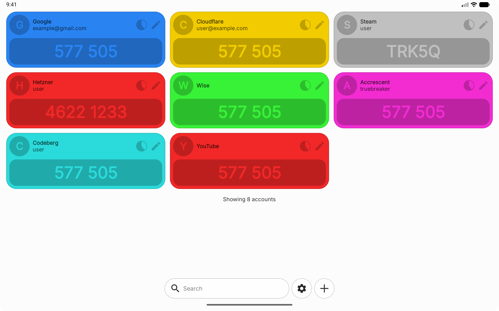

  

<h1 align="center">2fa</h1>
<h4 align="center">Manage one-time passwords securely, offline and without tracking</h4>

    

    
    
    

## Features

**2fa** is a dedicated multi-factor authenticator supporting HOTP, TOTP, and Steam codes. Its core is written in Rust and designed to be secure, fast, and simple.

Key features:

- **otpauth** links support:
    - Parse and import standard `otpauth://` URIs ([HOTP](https://www.rfc-editor.org/rfc/rfc4226), [TOTP](https://www.rfc-editor.org/rfc/rfc6238) & [STEAM](https://cs2central.gg/blog/steam-desktop-authenticator-guide/))
    - Scan QR codes to add accounts
    - Add `.maFile`'s for Steam codes

- Image support:
    - Receive shared images (files or gallery) to add accounts

- Security:
    - Biometric unlock
    - Block intents

- Account management:
    - Automatic internal backups
    - Export `.2fa`
    - Import `.2fa`
    - Export to Aegis `.json`
    - Import from Aegis `.json` (unencrypted vaults won't be supported)

- And more!

## Requirements

Android:
- Android 14 (SDK 34) or later (versions are always 2 years behind the latest stable update)
- Google Pixel 6a or better
- ARM64 (arm64-v8a) CPU

## Verifying Releases
All releases are signed with the followig certificate fingerprints:

- Android (SHA-256): `e5b28ea1e051c232dea94c27c0592e2c002d17c5ca81788b51306d608afe52c5`
    - `app.ninesevennine.twofactorauthenticator` (Standard)
    - `app.ninesevennine.twofactorauthenticator.accrescent` (Accrescent)
    - `app.ninesevennine.twofactorauthenticator.play` (Play Store) signed by Google

## Support

If you have any problems using **2fa**, you found a bug or just have a question, do not hesitate to reach us on:

- [TeamSpeak 6](https://tmspk.gg/u1MgFhv9)
- [Discord](https://discord.gg/zxgXNzhYJu)
- [Bluesky](https://bsky.app/profile/979.st)

If you would like to support and accelerate our work, please consider donating [here](https://979.st/donate/).

## License

This project is licensed under the EUPL v1.2, see the license file for details. 979 holds trademarks and patents covering all projects released and under development.