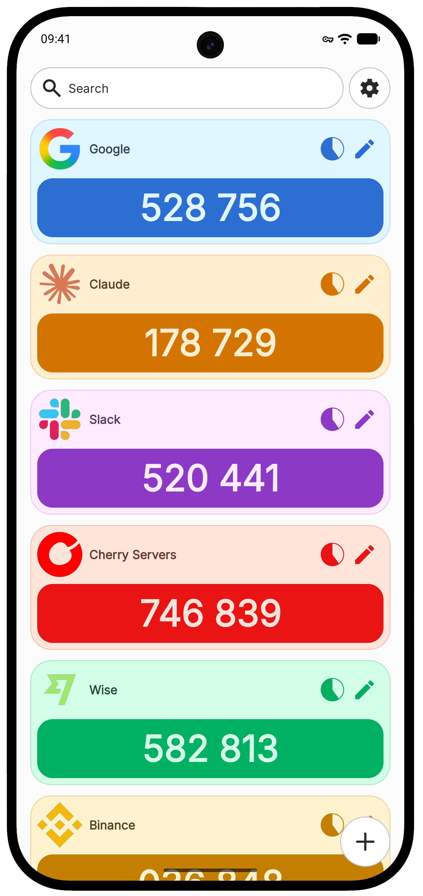
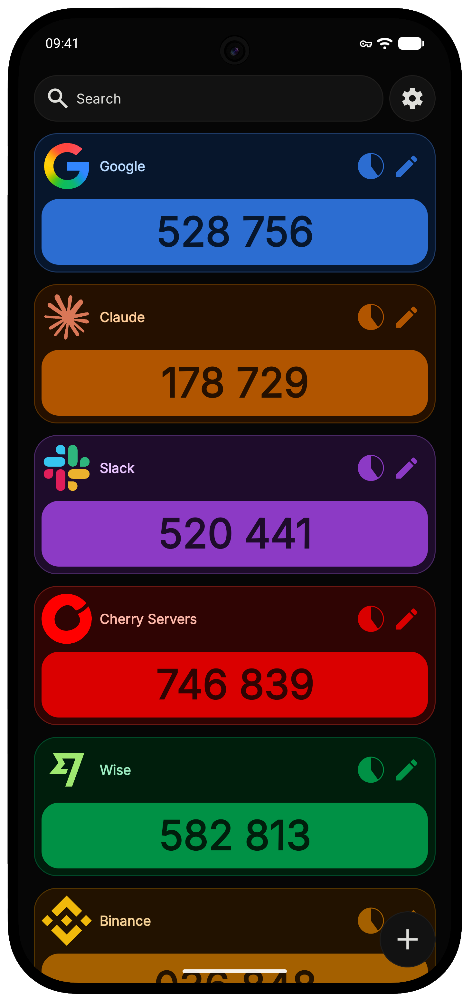

<p align="center">
  
</p>
<h1 align="center">2fa</h1>
<h4 align="center">A dedicated two-factor authenticator built to securely manage your one-time passwords</h4>
<p align="center">
    <a href="https://accrescent.app/app/app.ninesevennine.twofactorauthenticator.accrescent">
        
    </a>
</p>
<p align="center">
    
    
    
</p>

### Overview

2fa's only purpose is to provide single-use codes known as one-time passwords. It is a two-factor authenticator, and the concept is nothing new. There are plenty of other authenticators and alternatives with more features, but with worse security and privacy than ours. We built 2fa to take full advantage of your device's hardware security, along with the latest cryptographic standards, to keep your accounts safe. The app is offline and includes unique features that no other authenticator app offers.

### Features

- Support for TOTP, HOTP, and Steam Guard codes
- Add accounts via QR codes, otpauth links, files, or your gallery
- Highly customizable, with account colors and icon packs, including textured and tinted options
- Advanced security features such as biometric unlock, screen security, secure clipboard, memory wiping, and intent blocking
- Automatic backups, along with manual export and import of your accounts in `.2fa` or Aegis `.json` formats
- And more!

### Security

TODO

### Verifying Releases

All releases are signed, with the exception of the Google Play Store version, and must have the following SHA-256 certificate fingerprint.

```bash
e5b28ea1e051c232dea94c27c0592e2c002d17c5ca81788b51306d608afe52c5
```

### Support

If you have any problems using 2fa, you found a bug or just have a question, do not hesitate to reach us on [Discord](https://discord.gg/zxgXNzhYJu). If you would like to support and accelerate our work, please consider donating [here](https://979.st/donate/).